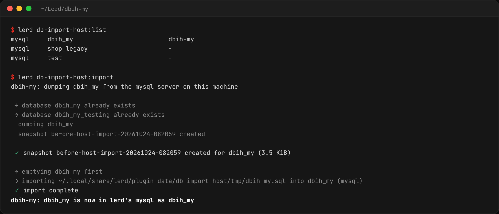

# Host database import for Lerd

> Move to [Lerd](https://lerd.sh) from Valet, Herd, DBngin or a MySQL installed
> with your package manager, data included. One command copies a site's
> database from the server on your machine into Lerd's own.

[](LICENSE)
[](https://plugins.lerd.sh)
[](https://lerd.sh)
[](https://reddit.com/r/lerd)
[](https://discord.gg/5JK54s7xCC)



Your sites link to Lerd in a minute, but their data is still in the MySQL, MariaDB or PostgreSQL server you were using before. This plugin copies it into Lerd's own database service, one site at a time or all at once, and only ever reads the server it copies from.

## Install

```bash
lerd plugin install db-import-host
```

## Use

See what is on the machine's server and which Lerd site each database fills, then import:

```bash
lerd db-import-host:list
cd ~/code/shop
lerd db-import-host:import
```

`lerd db-import-host:import shop blog` imports named sites and `--all` every site whose database exists on the machine's server. It is also in the site's **Commands** menu in the dashboard as **Import database from this machine**, and AI assistants get `db-import-host_list` and `db-import-host_import` through Lerd's MCP server. The full instructions are on the plugin's **Documentation** tab in the dashboard.

| Option | Meaning |
|---|---|
| `--all` | Import every site whose database exists on the machine's server |
| `--from` | The database on the machine's server, when its name differs from the site's |
| `--database` | The site's database in Lerd, when Lerd does not know it (WordPress, Drupal) |

By default it connects to `127.0.0.1:3306` as `root` with no password for MySQL and MariaDB, and `127.0.0.1:5432` as `postgres` for PostgreSQL. Save anything else once:

```bash
lerd db-import-host:connect mysql --user root --password secret
lerd db-import-host:connect mysql --socket /run/mysqld/mysqld.sock
lerd db-import-host:connect postgres --port 5433 --bin-dir /Applications/Postgres.app/Contents/Versions/latest/bin
```

## What it does

- Dumps the database with the machine's own `mysqldump`/`mariadb-dump` or `pg_dump`, skipping Lerd's shims of the same name, which run inside Lerd's containers and cannot reach the machine's server.
- Creates the site's Lerd database if needed and takes a `before-host-import` snapshot, so `lerd db:restore` undoes the import.
- Replaces what Lerd held for that database with the dump.
- Swaps a MariaDB dump's `utf8mb4_uca1400_*` collations and `NO_AUTO_CREATE_USER` sql mode for what MySQL accepts when the site uses Lerd's MySQL.
- Imports a database shared by several sites in a group only once with `--all`.

## What it reads, changes and sends

It reads the databases you import from the server on this machine, and never writes to that server. It reads the site list from Lerd's API. It replaces the site's Lerd database, after the snapshot. The dump is written to `tmp/` in the plugin's data folder and deleted once imported. The connection you save with `connect`, password included, is kept in `connection.json` in the same folder, readable only by you. Nothing leaves your machine.

## Requirements

- Lerd 1.38 or newer, and Node, which Lerd installs
- The client tools of the server you import from, on your `PATH` or found through `--bin-dir`

## Development

```bash
node --test test/
lerd plugin install .
```

## License

MIT
